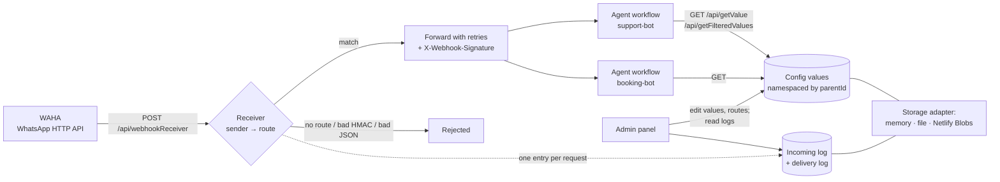

# agent-config-webhook-hub

[](https://github.com/s0yabean/agent-config-webhook-hub/actions/workflows/ci.yml)

A small config store and webhook receiver for AI agent workflows that run over WhatsApp through [WAHA](https://waha.devlike.pro/) (the self-hosted WhatsApp HTTP API). Agents read their settings from it, and it logs every webhook that arrives.

## The problem

Agent workflows that answer WhatsApp messages need settings: tone, reply length, escalation keywords, booking links, a directory that maps a chat ID to a customer name. Hard-coding those into each workflow means a redeploy or a workflow edit every time someone wants to change a sentence, and the person who wants the change usually isn't the one who can deploy.

The second problem is debugging. When an agent doesn't answer, the first question is whether the message reached it at all. WAHA fires a webhook, something receives it, something forwards it, and without a record of each step you are guessing which one failed.

## Approach

Two pieces behind one small API on Netlify Functions:

1. **Config values.** Namespaced string key-value pairs (`parentId` → `{key: value}`). Agents read them at run time with a `GET`; people edit them in an admin panel. Changing a value changes the agent's behaviour on its next run, with no redeploy.
2. **Webhook receiver and logs.** WAHA posts every event to one URL. The hub reads the sender's chat ID, looks up which agent workflow handles that sender, forwards the raw event to that workflow's webhook (with retries and an optional signature), and writes one log entry saying what happened: forwarded, rejected (and why), or failed.

It does not send WhatsApp messages or call WAHA's API. WAHA calls it.



What the API enforces:

- **Agents read, people write.** Read routes are open or gated by `AGENT_API_KEY`; every write, the webhook registry and the logs need an admin token from `POST /api/login`. The password is checked on the server.
- **Strict routing.** A route maps one WhatsApp sender (`<digits>@c.us`) to one agent webhook. Unknown or paused senders are rejected and logged, not forwarded. Two active routes can't claim the same sender.
- **Bounded retries.** Up to 3 attempts with a 2.5 s timeout each, retrying network errors, `429` and `5xx` only, so the worst case fits inside Netlify's default 10 s function limit.
- **Secrets stay on the server.** A route's signing secret is never returned by the API; the panel only sees `hasSecret`.

Full contract with curl examples: [docs/api.md](docs/api.md).

## Results

This was an internal tool, and no numbers from it have been published, so none are claimed here.

What has been checked in this repo, on synthetic data:

- `npm test` runs 51 vitest tests against the real handlers on the in-memory store with a fake `fetch`: save/get/filter/delete of values, merge vs replace, parent IDs, password check and session tokens, the agent read key, webhook validation and secret redaction, test sends, routing, retries, inbound HMAC, log caps, and the file store with the seed.
- `npx tsc --noEmit` (strict) and `npm run build` pass.
- `npm run dev` plus `npm run send-sample` was run end to end: two events forwarded to the mock agents, one failed after 3 attempts against a target that always returns 500, two rejected (paused route, unknown sender), all five visible in the incoming log.

## Quickstart

Requires Node 20+. No Netlify account or keys.

```bash
npm ci
npm test                 # 51 tests, no network
npm run dev              # http://127.0.0.1:8888  (API + admin panel + mock agent targets)
```

On first run the file store in `data/local/` is filled from `data/seed.json`: four config namespaces and four webhook routes, all **synthetic** (fictional names, `555-01xx` numbers, `example.com` URLs). `npm run seed` resets it.

In a second terminal, play WAHA:

```bash
npm run send-sample      # posts 5 synthetic WAHA "message" events to the receiver
curl "http://127.0.0.1:8888/api/getValue?parentId=support-bot&key=max_reply_chars"
curl http://127.0.0.1:8888/mock-agent    # what the mock agent workflows received
```

Then open the panel's **Incoming webhooks** tab to see each event and why it was forwarded, rejected or failed.

### Deploying on Netlify

1. Connect the repo to a Netlify site. `netlify.toml` builds the UI, serves the functions and maps `/api/*` to them.
2. Set `ADMIN_PASSWORD` (required; admin routes return `503` without it). Optionally set `AGENT_API_KEY`, `INBOUND_HMAC_SECRET`, `SESSION_SECRET`.
3. On Netlify the store backend defaults to Netlify Blobs. Point WAHA's webhook at `https://<your-site>/api/webhookReceiver`.

All variables are described in [.env.example](.env.example).

## Repo layout

```
netlify/functions/        one thin file per function, all calling src/server/handlers.ts
src/server/
  handlers.ts             HTTP layer: methods, auth level, status codes
  values.ts               namespaced config: merge/replace, filter, delete, parent IDs
  webhooks.ts             route registry, validation, secret redaction, capped logs
  receiver.ts             sender extraction, HMAC, routing, forward with retries
  auth.ts                 server-side password check, session tokens, agent key
  store.ts                BlobStore interface + memory, file and Netlify Blobs backends
  deps.ts, netlify.ts     real dependencies; Netlify Functions wrapper
src/ui/                   React admin panel: config values, webhook routes, incoming log
scripts/
  local-server.ts         one-process local server (functions + Vite + mock agents)
  seed.ts, seed-lib.ts    load data/seed.json into the file store
  send-sample-webhook.ts  synthetic WAHA events
data/seed.json            synthetic sample data
test/                     vitest suites
docs/api.md               API contract
```

## Design decisions

- **One storage interface, three backends.** The original read and wrote Netlify Blobs directly in every function. Putting `get / set / delete / listKeys` behind an interface (`STORE_BACKEND=memory|file|netlify`) is what lets the tests and the quickstart run offline while the deployed path stays on Blobs.
- **The password moved to the server.** The first version compared the password in the browser against a build-time variable, which put it in the shipped JavaScript, and the API routes behind the panel were open. Now `POST /api/login` checks it in constant time and returns a signed, expiring token that admin routes require.
- **Deleting a key is its own operation.** The panel used to delete a key by saving the map without it, but saving merges, so the key survived. There is now `deleteValue`, and `saveValues` takes `mode: "replace"` when you mean "make it exactly this".
- **One log entry per request.** Each request that reaches the receiver gets one entry with its final status and reason, so the log reads as a list of events rather than pairs to match up.
- **Retries sized to the platform.** The original waited 1 s, 5 s and 15 s between attempts inside a function with a 10 s limit. Now the delays are short, the timeout is bounded, and a `4xx` from the agent is treated as an answer, not retried.
- **Strings only.** Values are always strings, so an agent never has to guess a type.

## What I'd do next

- Conditional writes (ETags) on the Blobs path. Each namespace is one blob, rewritten whole, so two simultaneous saves can lose one of them.
- Retention and redaction for the incoming log. It stores message text for debugging; it should expire, and `LOG_RAW_PAYLOADS=false` should probably be the default outside development.
- Acknowledge WAHA immediately and forward from a background function or queue, so a slow agent never holds the webhook open.
- Per-agent read keys and scopes instead of one shared `AGENT_API_KEY`.
- Support WhatsApp ID formats beyond `@c.us` / `@g.us` in routing.

Part of the AI systems I build at [tonytonggg.com](https://tonytonggg.com).

## Licence

MIT © Tony Tong.
